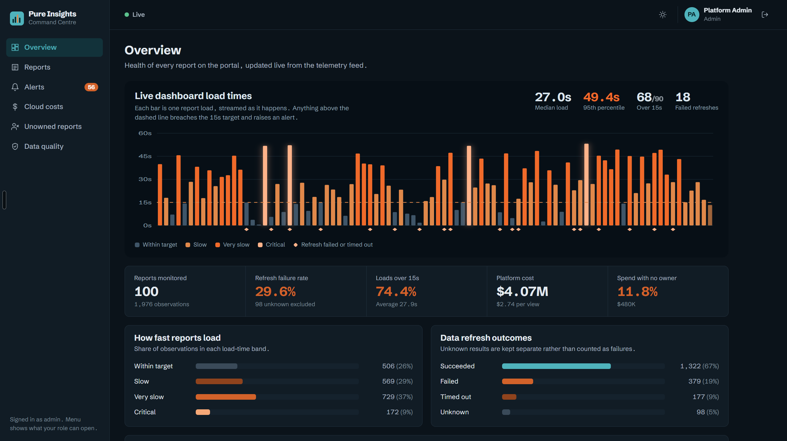
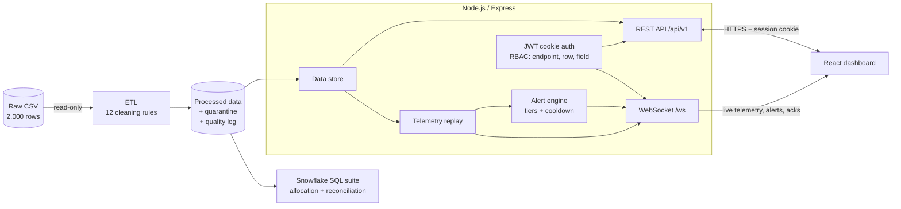

# Pure Insights Command Centre

An operational admin console for the analytics portal (React · Node.js/Express · WebSocket · Snowflake SQL).

After the move from Tableau Server to a custom portal, the business lost visibility of report usage, refresh failures, report ownership and Snowflake spend. This project restores it:

- **Live load-time monitoring** with real-time alerts when a dashboard takes longer than 15 seconds or a data refresh fails
- **Ownership tracking** that finds unowned (orphaned) reports and the money spent on them
- **Cloud cost attribution**: Snowflake credits and AWS hosting cost per report, cost per view, and rules that flag where to act
- **Role-based access** at three levels (endpoint, row and field), applied to the REST API and the WebSocket alike
- **An auditable data pipeline**: every data quality issue in the export is detected, logged and handled, never silently dropped



---

## Run it

**Prerequisites:** Node.js 20.12 or newer. Python 3 is optional and only needed for the SQL verification script.

```bash
npm run setup     # installs server and client dependencies
npm test          # 70 automated tests (60 server, 10 client)
npm run build     # builds the dashboard
npm start         # cleans the data, then serves API + dashboard + WebSocket
```

Open **http://localhost:4000**.

No configuration is needed to try it: without a `server/.env` the server runs in **demo mode**, and the login screen fills in the demo password for you.

### Sign in

| Role | Email | Sees |
|---|---|---|
| Admin | `admin@pureinsights.local` | Everything, plus start/pause of the live feed |
| Analyst | `analyst@pureinsights.local` | All reports, costs, unowned reports, data quality |
| Report owner | `user_3@company.com` | Only the 11 reports they own, and only their alerts |
| Viewer | `viewer@pureinsights.local` | Report health and alerts, with no cost figures |

Password for all accounts in demo mode: **`pureinsights-demo`**. Signing in as each role shows the access rules at work.

### Development mode (hot reload)

```bash
npm run dev:server   # terminal 1: API on :4000
npm run dev:client   # terminal 2: dashboard on :5173 (proxies /api and /ws to :4000)
```

### Configuration

Copy `server/.env.example` to `server/.env` to change anything: port, thresholds, credit price, rate limits, paths. Nothing is hard-coded. In production (`NODE_ENV=production`) the server refuses to start without `JWT_SECRET` and `DEMO_PASSWORD`, and demo mode is disabled.

---

## Deliverables

| Brief requirement | Where |
|---|---|
| Runnable full-stack codebase (React + Node.js) | `client/`, `server/` |
| RBAC dashboard for system health and orphaned reports | Overview, Reports, Unowned reports pages; `server/src/auth`, `server/src/domain/access.js` |
| Real-time alerts for load time over 15s and failed refreshes | `server/src/alerts`, `server/src/realtime/ws.js`; Alerts page and live chart |
| Snowflake cost attribution and unit cost per view | `sql/01–07`, verified by `scripts/verify_sql.py` |
| REST API & WebSocket technical specification | [`docs/API_SPEC.md`](docs/API_SPEC.md) |
| Data quality defects identified, cleaned and documented | `server/src/etl`, [`docs/DATA_QUALITY_LOG.md`](docs/DATA_QUALITY_LOG.md) (generated) |

---

## Architecture



**How a live alert travels:** the replay simulator emits a reading → the alert engine checks thresholds and cooldown → the WebSocket layer sends it only to users allowed to see that report → the dashboard adds a bar to the live chart, updates the alert counter and pops a notification if it's critical.

**Why replay?** The export has no timestamps, so the server replays the 1,976 clean observations in file order, one per second, as if they were arriving live. In production, the `ReplaySimulator` would be replaced by a real feed (portal load-time metrics, Snowflake task history). The alert engine, the WebSocket layer and the UI would not change.

**Why one data store module?** `server/src/data/store.js` is the only module that reads data. Pointing it at the Snowflake `PI_CORE` views instead of local files would not change any route.

---

## What the data showed

### Data quality (all handled in `server/src/etl/clean.js`, logged per rule)

| Issue | Rows | Handling |
|---|---:|---|
| Owner missing (`nan`) or `ORPHANED_REPORT` | 245 | Kept and flagged as orphaned; these rows *are* the orphaned-reports finding |
| Negative Snowflake credits | 24 | Quarantined with the source row number; excluded from cost (−161.04 credits) |
| Load time above 15s (up to 55s) | 1,490 | **Kept.** Spikes are the signal the alerts exist for; tiered by severity |
| Refresh status `UNKNOWN` | 100 | Kept, but excluded from the failure rate rather than guessed as a failure |
| Zero monthly views | 4 | Kept; cost per view is `null`, never divided by zero |

Two findings the brief did not mention:
- **Owners change constantly.** Each report has 7–14 different owners across its 20 observations. Ownership is therefore reported as *latest known owner* plus *how often it changed*.
- **74% of observations breach 15s.** Alerting on every breach would be noise, so alerts have severity tiers and a per-report cooldown that escalation breaks through.

### Cost (at an assumed $3 per Snowflake credit, configurable)

- **Total spend $4.07M:** $3.62M Snowflake plus $0.46M AWS, at **$2.74 per view**.
- **$480K (11.8%) was spent while reports had no owner.** Nobody was accountable for that spend.
- **Spend is evenly spread:** it takes 77 of 100 reports to reach 80% of cost. Savings need platform-wide fixes, not a few expensive dashboards.
- **10 reports flagged:** 8 for hosting review (top-quartile AWS cost, bottom-quartile usage) and 2 for query optimisation (cost per view is an outlier).

---

## Cloud cost SQL (`sql/`)

| File | Purpose |
|---|---|
| `01_schema.sql` | Database, `PI_RAW` / `PI_CORE` schemas, tables, cost assumptions table |
| `02_load.sql` | `PUT` + `COPY INTO` from the ETL output (Snowflake only) |
| `03_core_views.sql` | Validated usage, report health, ownership (`LAG`, `QUALIFY ROW_NUMBER`) |
| `04_cost_allocation.sql` | Cost per report, weighted cost per view, unowned spend |
| `05_rankings_and_flags.sql` | Rank, Pareto curve, IQR outliers, AWS-vs-usage mismatch |
| `06_reconciliation.sql` | Proves the numbers: every row accounted for once, credits conserved, shares sum to 1 |
| `07_production_template.sql` | The same method on a live account using `ACCOUNT_USAGE.QUERY_ATTRIBUTION_HISTORY`, with warehouse idle time shared out proportionally |

**Verification without a Snowflake account:**

```bash
pip install -r requirements.txt
python scripts/verify_sql.py
```

This runs files 01 and 03–06 on DuckDB (same SQL features: CTEs, window functions, `QUALIFY`, `PERCENTILE_CONT`), checks that every reconciliation row says PASS, and confirms that the SQL results equal the Node pipeline's results for all 100 reports.

Honest limits: files 01–06 were verified on DuckDB, not on a live Snowflake account. `07_production_template.sql` was tested on a small known-answer fixture (each warehouse's allocated credits sum exactly to its bill), not against real `ACCOUNT_USAGE` data.

---

## Security

- **Session:** JWT in an `HttpOnly`, `SameSite=Strict` cookie (`Secure` in production). No token is stored in JavaScript or put in a URL. The signing algorithm is pinned, so forged and unsigned tokens are rejected (tested).
- **Passwords:** bcrypt hashes only. Unknown emails and wrong passwords give identical, equally slow responses.
- **Access:** permissions are checked on the server for every request and every WebSocket message. The UI hides what a role can't use, but the server is the authority.
- **WebSocket:** session and `Origin` are checked before the upgrade (cross-site hijacking protection), message size is capped, dead connections are dropped by heartbeat, and the socket closes when the session expires.
- **Input:** query parameters are allow-listed and bounded; request bodies are capped at 10 KB.
- **Headers and limits:** Helmet security headers, CORS restricted to configured origins, rate limits on login and API.
- **Dependencies:** `npm audit` reports 0 vulnerabilities for server and client.

---

## Tests

```bash
npm test
```

| Suite | What it covers |
|---|---|
| `server/test/clean.test.js` | Every cleaning rule, boundaries (15.0s vs 15.1s), conservation (clean + quarantined = input) |
| `server/test/api.test.js` | Login, cookie flags, forged and unsigned tokens, RBAC at all three levels, validation, and totals that match the SQL suite |
| `server/test/alerts.test.js` | Thresholds, severity tiers, cooldown, escalation, buffer cap, acknowledgement, replay |
| `server/test/realtime.test.js` | WebSocket auth and Origin rejection, owner-scoped delivery, live ack broadcast, oversized messages |
| `client/src/lib/*.test.js` | Live-feed reducer, reconnect backoff, number formatting |

Three independent implementations agree on every figure: the Node ETL, the Node API cost model and the SQL suite. The API tests and `verify_sql.py` check this.

---

## Project structure

```
├── data/raw/                 Original export (never modified)
├── docs/                     API spec, generated data quality log, screenshots
├── sql/                      Snowflake cost allocation suite (01–07)
├── scripts/verify_sql.py     Runs the SQL locally and cross-checks it
├── server/
│   ├── config/users.json     Demo identities and roles
│   └── src/
│       ├── etl/              CSV parsing and cleaning rules
│       ├── config/           Settings, secrets, thresholds (all from .env)
│       ├── auth/             Roles, permissions, tokens, users
│       ├── domain/           Cost model, health KPIs, row and field access
│       ├── alerts/           Alert engine and telemetry replay
│       ├── realtime/         WebSocket server
│       ├── routes/           REST endpoints
│       └── http/             Auth middleware, errors, validation, logging
└── client/src/
    ├── pages/                Overview, Reports, Report detail, Costs, Unowned, Alerts, Data quality
    ├── components/           Live load-time chart, shell, UI kit
    ├── realtime/             WebSocket provider with reconnect
    └── lib/                  API client, live-feed reducer, formatting
```

---

## Assumptions and limitations

- **Row order is time order.** The export has no timestamp column, so file order is treated as chronological. This affects only "latest known owner" and the replay order.
- **Credit price** is assumed at $3.00 per credit (`USD_PER_CREDIT`, and the `COST_ASSUMPTIONS` table in SQL). Replace it with the contracted rate.
- **Cost attribution is direct:** each observation's credits are already tagged to one report (in production, via `QUERY_TAG`). Idle warehouse time is handled in the production template.
- **Alerts are held in memory** (last 500). A production deployment would persist them (for example in Postgres) and run the API behind HTTPS.
- **Users come from a JSON file** with one shared demo password. In production this would be the company identity provider (SSO/OIDC). Only `server/src/auth/users.js` would change.
- **Single instance.** WebSocket fan-out runs in one process. Horizontal scaling would add a pub/sub channel (for example Redis) between the alert engine and the socket servers.